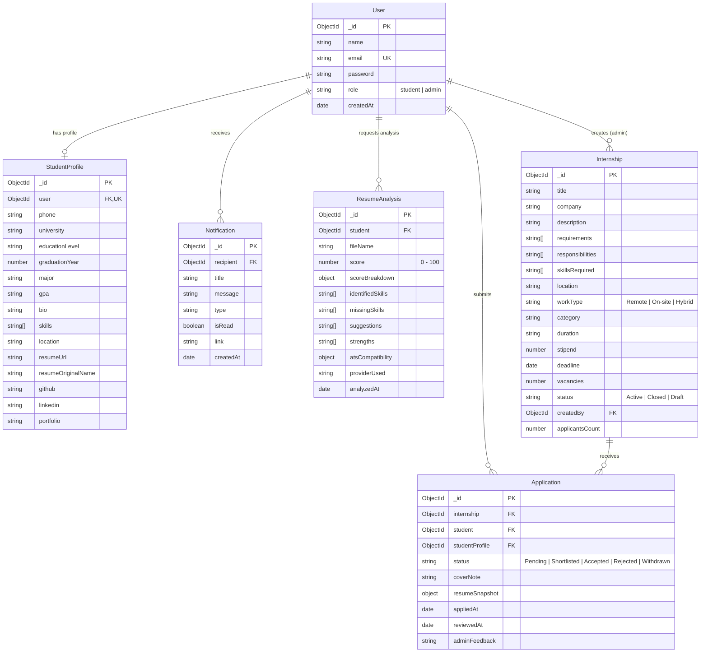
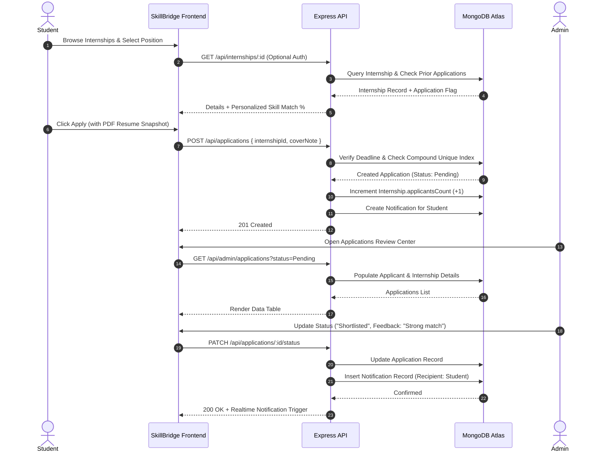

# SkillBridge System Architecture & Technical Design

## 1. Architectural Overview

SkillBridge is built as a modular, three-tier Full-Stack MERN application adhering to RESTful API principles, role-based access control (RBAC), and deterministic algorithmic intelligence.

```
+-------------------------------------------------------------------------+
|                              CLIENT LAYER                               |
|        React 18 + Vite SPA, React Router v6, Axios, Lucide Icons       |
+------------------------------------+------------------------------------+
                                     |  HTTPS / JSON / Bearer JWT
+------------------------------------v------------------------------------+
|                             BACKEND LAYER                               |
|               Node.js + Express.js Modular RESTful API                  |
|  - Security: Helmet, CORS allowlist, Express Rate Limit, BcryptJS       |
|  - Middlewares: JWT Auth, RBAC ('student' | 'admin'), Multer Validation |
|  - Services: Deterministic Skill Matcher & ATS Resume Diagnostics       |
+------------------------------------+------------------------------------+
                                     |  Mongoose ODM (Driver v8)
+------------------------------------v------------------------------------+
|                            DATABASE LAYER                               |
|                     MongoDB (Local / Atlas Replica)                     |
|  - Collections: Users, StudentProfiles, Internships, Applications,      |
|                 ResumeAnalyses, Notifications                           |
|  - Indexes: Unique Compound, Text Search, Ascending Expiration         |
+-------------------------------------------------------------------------+
```

---

## 2. Entity-Relationship Model



---

## 3. Application Lifecycle & Status Flow



---

## 4. AI Engine Architecture

### A. Deterministic Skill Matching Algorithm
1. **Input**: Student profile skills array and internship required skills array.
2. **Normalization**:
   - Trim whitespace and lowercase text.
   - Map aliases using standard dictionary (e.g. `react.js` $\rightarrow$ `react`, `nodejs` $\rightarrow$ `nodejs`, `ts` $\rightarrow$ `typescript`).
   - Deduplicate inputs using Sets.
3. **Comparison**:
   - Exact token matching against canonical names.
   - Substring fuzzy matching for multi-word technologies.
4. **Scoring**:
   $$\text{Match Percentage} = \text{round}\left(\frac{|\text{Matched Skills}|}{|\text{Normalized Required Skills}|} \times 100\right)$$
5. **Output**: Transparent breakdown of matched skills, missing skills, and mandatory advisory disclaimer.

### B. Hybrid ATS Resume Analyzer
1. **PDF Extraction**: Reads PDF binary buffers using `pdf-parse`, stripping control sequences while retaining structure.
2. **Analysis Pipeline**:
   - **Contact Verification (15 pts)**: Email regex, phone regex, LinkedIn, GitHub, portfolio presence.
   - **Academic Verification (15 pts)**: Degree level, institution keywords, graduation year, GPA indicators.
   - **Skills Extraction (30 pts)**: Dictionary comparison across 70+ languages, frameworks, cloud tools, databases.
   - **Impact & Experience (25 pts)**: Projects/experience headers, action verbs, quantifiable metrics.
   - **ATS Structure (15 pts)**: Section headings and word density benchmarks.
3. **Provider Fallback**:
   - If `AI_PROVIDER` and `AI_API_KEY` are provided, calls external LLM provider with strict JSON output schema.
   - If external API times out, exceeds quota, or is unconfigured, smoothly falls back to the deterministic rule-based engine (`providerUsed: 'rule-based-fallback'`), ensuring zero service interruption.
